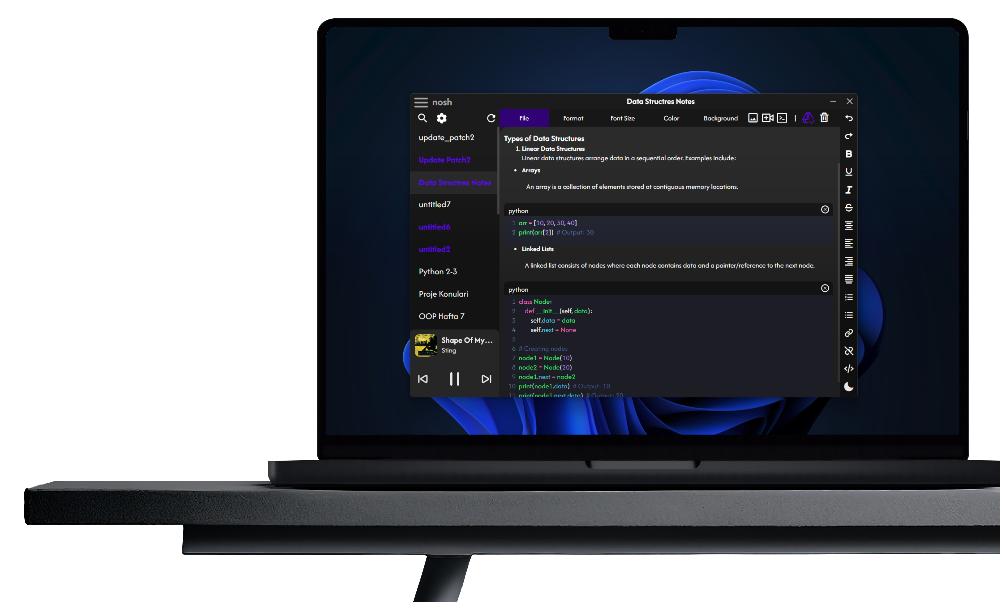

# ⚡ NOSH

### The Distraction-Free Code Notepad Every Developer Wish They Had.

**Instant Startup. 15+ Language Code Blocks. Native Spotify Playback. Seamless Google Drive Sync.**

 

 

  
  &nbsp;&nbsp;
  

---

 

## 😫 Sound Familiar?

> *"I just need to copy a 10-line Python snippet, but opening VS Code takes 15 seconds, indexes 40,000 files, and spins up 18 extensions."*
>
> *"Standard Windows Notepad destroys my formatting, turns tabs into weird spaces, and has zero syntax highlighting."*
>
> *"Switching windows constantly just to skip a song on Spotify breaks my coding flow."*

### 👉 Enter **Nosh**. The sweet spot between a rapid notepad and a programmer's editor.

 

---

## 🌟 Why Developers Love Nosh

<table>
<tr>
<td width="50%">

### 💻 15+ Language Syntax Highlighting
Write code blocks directly in your notes. Nosh detects and styles **Python, JavaScript, C++, Java, Rust, Go, SQL, HTML/CSS, Shell, Markdown** and more. Clean indents, bracket matching, and monospace typography.

</td>
<td width="50%">

### 🎵 Native Spotify Control Bar
Control your music **without ever leaving your note**. See live song titles, artist names, album covers, and adjust volume via a sleek radial dial. Stay locked in deep flow state.

</td>
</tr>
<tr>
<td width="50%">

### ☁️ Google Drive Auto-Sync
Never lose a snippet. Nosh automatically links with your personal Google Drive, maintains your `.nsh` workspace folder, and synchronizes your notes across your devices safely and privately.

</td>
<td width="50%">

### ⚡ Instant Launch & Zero Lag
Engineered to open in milliseconds. No heavy language servers, no background indexing, no cloud telemetry. Just pure, distraction-free writing speed.

</td>
</tr>
</table>

 

---

## 🖥️ A Sneak Peek Inside

  
  
<em>The Nosh workspace: dark-mode canvas, embedded code blocks, and the native Spotify widget.</em>

 

---

## 🚀 How It Stacks Up

| Feature | Standard Notepad | Heavy IDEs (VS Code) | ✨ **NOSH** |
| :--- | :---: | :---: | :---: |
| **Instant Launch (< 1 sec)** | ✅ | ❌ (5-15s) | ✅ **Lightning fast** |
| **Code Syntax Highlighting** | ❌ | ✅ | ✅ **15+ Languages** |
| **Built-in Spotify Remote** | ❌ | ❌ (Extension clutter) | ✅ **Native & seamless** |
| **Google Drive Cloud Sync** | ❌ | ❌ (Manual Git) | ✅ **1-Click automated** |
| **Memory Footprint** | Low | Very High (1GB+) | 🟢 **Ultralight** |
| **Price** | Free | Free | 🎁 **100% Free & Open Source** |

 

---

## 📥 Download Nosh

Get the latest stable release for Windows:

| Release | Platform | Size | Download Link |
| :--- | :--- | :--- | :--- |
| **v1.3.4 (Latest)** | Windows 10 / 11 (64-bit) | ~99 MB | [**Download Nosh v1.3.4**](https://drive.google.com/file/d/16yYs2YP2uiiBRqtOq2pzpqH1I5x278Wt/view?usp=sharing) 🚀 |
| **v1.3.2** | Windows (64-bit) | ~75 MB | [Download v1.3.2](https://drive.google.com/file/d/18eJ6CCnOA87BPHexw6TU-0Qtf28-BEiO/view?usp=sharing) |
| **v1.3.1 Alpha** | Windows (64-bit) | ~75 MB | [Download v1.3.1 Alpha](https://drive.google.com/file/d/1wVXoHRv5g_djpirPmw6j0RVFkEOsNxKf/view?usp=sharing) |
| **v1.2.0** | Windows (64-bit) | ~74 MB | [Download v1.2.0](https://drive.google.com/file/d/1-Pxn41riMJjvy8Hhl12un9yB-bPSReGL/view?usp=drive_link) |

> 💡 **Want to build from source or contribute?**
> The full source code is available at [**github.com/CGhost1908/nosh-source**](https://github.com/CGhost1908/nosh-source). Give it a star ⭐!

 

---

## 💬 Community & Feedback

Found a bug? Want support for a new programming language or feature?
- 🐛 **Report Issues**: [Open an issue on GitHub](https://github.com/CGhost1908/nosh-source/issues)
- 📬 **Email Creator**: `noshthenotepad@gmail.com`

 

**Crafted with ❤️ for developers who love clean, fast tools.**

*© 2025-2026 Nosh. Free & Open Source under the MIT License.*

